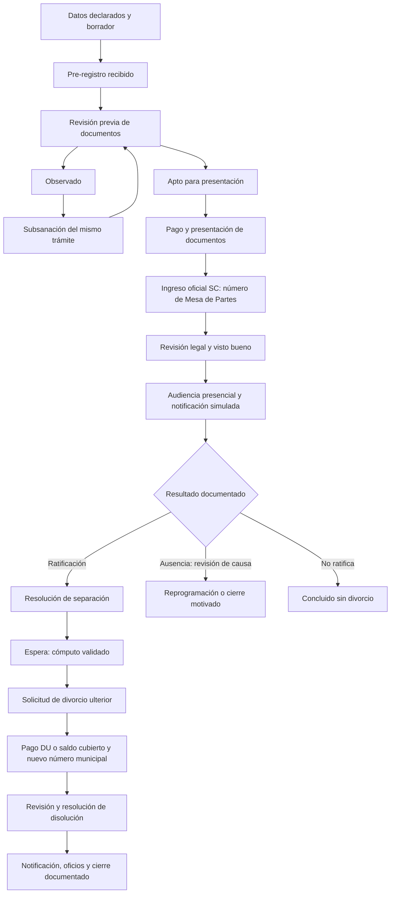

# Requisitos trazables y flujo objetivo

Leer junto a `02-fuentes-y-decisiones.md`. A0–A5 son grabaciones; I es la fotografía; F01–F06 son formularios; C es código; U es el encargo. **Confirmado documental** significa constatado en la fuente indicada, no certificación de vigencia jurídica. **Propuesto** es una decisión de diseño técnico. **Pendiente** necesita respuesta municipal.

## Síntesis de cada grabación

| Fuente y ventana | Tema reconocido | Interpretación para el proyecto |
|---|---|---|
| A0 00:13–00:25, A4 01:03–01:46 | Matrimonio en distrito o último domicilio | Alternativa territorial, no requisito de residencia actual conjunta |
| A0 00:27–01:00, A4 01:23–02:13 | Pago conjunto o fraccionado, revisión de documentos | Dos conceptos con posibilidad de abono total. No usar las cifras de la transcripción |
| A1 00:29–01:24 | No devolver datos de identidad | Separar identificación declarada y verificación; no autocompletar información privada de terceros |
| A1 01:24–02:21 | Dirección del DNI no coincide con residencia | Recoger domicilio actual de cada parte |
| A1 02:21–03:15 | Datos de ambos cónyuges y quien registra | Etiquetas neutrales cónyuge 1/2 y registrante separado |
| A1 03:15–05:19 | Matrimonio, familia, bienes, exterior | Mantener condiciones; audio parcialmente ambiguo, contrastado con I/F |
| A1 06:32–06:54 | Ver archivo subido | Vista previa del archivo real antes de enviar |
| A2 00:01–00:38 | Abogada revisa y observa | Revisión previa y devolución visible al ciudadano |
| A2 01:22–03:10 | No bloquear por tres caracteres de dirección; nombres declarados | Simplificar registro, sin consulta de identidad obligatoria inicial |
| A3 00:00–01:56 | Seguimiento solo DNI es insuficiente; evitar claves difíciles de recordar | Acceso complementario y recuperación sencilla; mecanismo no cerrado |
| A3 01:57–03:04 | Subsanar en lugar de iniciar todo otra vez | Mantener ID y antecedentes; edición restringida al interesado autorizado |
| A3 03:04–04:23 | Posible exigencia académica de seguridad y fricción de cuentas | Propuesta técnica diferenciada de decisión del ingeniero; no atribuirle aprobación de OTP |
| A3 04:23–05:15 | Facilitar a ciudadanía y personal | Reducir consultas presenciales y trabajo repetido; orientación accesible |
| A4 00:00–00:32 | Ejemplos por documento | Catálogo de formatos, no PDF genérico repetido |
| A4 00:32–01:03 | Acta de matrimonio reciente | Registrar expedición y mostrar referencia de tres meses |
| A5 00:00–00:56 | Pre-registro revisado antes de acercarse | “Apto para presentación” previo al ingreso oficial |
| A5 00:56–01:25 | Poder especial, no cualquier poder | Capturar inscripción y revisión de facultades para divorcio municipal |
| A5 01:25–03:37 | DEMUNA/conciliación, alimentos/tenencia/visitas | Checklist de tres materias; una sentencia de alimentos sola no completa el requisito |
| A5 03:37–04:02 | Bienes y escritura pública | Separar régimen y documento inscrito; no automatizar excepción sobre bienes no inscritos |
| A5 04:02–05:33 | Teléfono, matrimonio y dos años | Añadir contacto y validación de fecha ya parcialmente existente |
| A5 07:19–07:50 | Poder con partida/código | Metadata registral de representación |
| A5 07:50–08:32 | Solicitud/DJ con firmas y huellas escaneadas | Descargar, imprimir, completar/firmar y subir escaneo; no firma digital ficticia |
| A5 08:33–09:45 | Inicio del trámite en Mesa de Partes y reportes de resoluciones mensuales | Separación de fases, reporte por resolución y exportación; mención de Excel no basta para diseñar importador |
| A5 09:46–10:48 | Segunda solicitud y segundo número municipal; oficios con segundo número | Dos expedientes oficiales enlazados en un solo caso funcional |
| A5 10:48–11:47 | Consignar número, corregir documentos, luego Mesa de Partes | Referencia manual auditada y ciclo de subsanación |
| A5 11:47–12:24 | Propuesta de avisos WhatsApp; audiencia presencial | Notificación mock revisable y agenda exclusivamente presencial |

A0 y A4 tienen contenido similar; no cuentan como dos confirmaciones independientes de montos. A1 05:19–06:32 y A5 05:33–07:19 contienen fragmentos escasamente interpretables; no se derivan requisitos nuevos de ellos. En A5 09:46–10:48 la explicación posterior aclara el segundo número pese a una frase inicial ambigua. Falta confirmar el formato exacto, no la necesidad de soportar dos referencias.

## Matriz de requisitos

P0: necesario para la demostración integral. P1: siguiente mejora; no se elimina del alcance global. Los códigos de aceptación se desarrollan en `06-ejecucion-y-pruebas.md`.

| ID | Requisito | Evidencia / naturaleza | Cambio verificable | Prioridad / prueba |
|---|---|---|---|---|
| RF01 | Pre-registro simple con datos declarados | A1/A2; confirmado en conversación | Retirar código de dirección obligatorio y autocompletado de padrón; DNI no verifica identidad por sí mismo | P0 / QA01 |
| RF02 | Registrante separado de cónyuges | A1 02:46–03:15, T | Cónyuge 1/2, representante y relación explícitos | P0 / QA02 |
| RF03 | Domicilios actuales y contacto | A1, A5 04:02–04:31, F01/F02 | Dirección individual, dirección conyugal y teléfono; correo según canal de acceso | P0 / QA02 |
| RF04 | Mutuo acuerdo, antigüedad y competencia | W, I, A4, F01 | Validación de fecha y alternativa territorial; motivo de orientación cuando no cumple | P0 / QA03 |
| RF05 | Hijos menores y mayores diferenciados | I, F03/F04 | Ramas independientes; no exigir conciliación por todo hijo adulto | P0 / QA04 |
| RF06 | Declaraciones faltantes | I, F03/F04/F05 | Dos DJ de hijos y DJ de bienes según condiciones | P0 / QA04 |
| RF07 | Matrimonio: expedición reciente | I, A4 | Fecha de expedición y alerta de vigencia | P0 / QA05 |
| RF08 | Documentación de hijos y materias | I, A5 01:53–03:37 | Actas por hijo aplicable y alimentos/tenencia/visitas cubiertos, incluso con varios documentos | P0 / QA06 |
| RF09 | Patrimonio correctamente denominado | I, F05, A5 03:37–04:02 | DJ o escritura inscrita; no reducir a “acuerdo notarial” genérico | P0 / QA07 |
| RF10 | Poder especial e inscripción | I, A5 00:56–01:25 y 07:19–07:50 | Representante, representado, facultades, partida y archivo | P0 / QA08 |
| RF11 | Ejemplo específico por requisito | A4, seis F | Abrir/descargar formato correspondiente; orientar si no existe plantilla | P0 / QA09 |
| RF12 | Firmas/huellas mediante escaneo | A5 07:50–08:32, F | Guía imprimir/completar/firmar/subir; aceptación web no sustituye firma | P0 / QA09 |
| RF13 | Carga real de demo con vista previa | A1 06:32–06:54, U | Archivo, metadata, errores, reemplazo/versionado y recuperación | P0 / QA10 |
| RF14 | Envío genera caso persistente | U, brecha C | ID/código únicos, constancia y aparición inmediata en bandeja | P0 / QA11 |
| RF15 | Revisión remota antes de presentación | A2, A5 00:00–00:56 | Recibido → revisión previa → observado/apto para presentación | P0 / QA12 |
| RF16 | Observaciones y subsanación sobre mismo caso | A3 01:57–03:04 | Motivo específico, nuevas versiones, historial y reenvío | P0 / QA13 |
| RF17 | Consulta protegida y fácil de recuperar | A3; mecanismo propuesto | No revelar expediente por DNI aislado; contacto y challenge demo; ayuda presencial | P0 / QA14 |
| RF18 | Dos conceptos de pago y pago conjunto | I, A0/A4/A5 | Comprobante, validación, asignación SC/DU y saldo coherente | P0 / QA15 |
| RF19 | Dos números oficiales vinculados | A5 09:46–10:48 | Registrar referencia SC y otra DU sin perder expediente padre | P0 / QA16 |
| RF20 | Códigos por tipo de procedimiento | T; exactos pendientes | Catálogo editable/configurado, identificadores demo no oficiales | P0 / QA16 |
| RF21 | Audiencia presencial vinculada | A5 11:47–12:24 | Agenda real, sede, participantes, colisiones y expediente | P0 / QA17 |
| RF22 | Asistencia, ratificación y acta | Flujo legal + propuesta técnica | Resultado por parte, acta y transición justificada | P0 / QA18 |
| RF23 | Reprogramación y conclusión diferenciadas | Reglamento + propuesta técnica | Preservar convocatoria, causa y cierre sin disolución cuando proceda | P0 / QA18 |
| RF24 | Separación y divorcio son etapas distintas | F01/F06, A5 | Resolución SC, espera/habilitación, solicitud DU y resolución DU | P0 / QA19 |
| RF25 | Plazos explicables y configurables | Contradicción C/A/F; pendiente Q03 | Fechas separadas, regla con fuente y calendario; no contador desde prerregistro | P0 / QA20 |
| RF26 | Avisos de audiencia por WhatsApp simulados | Propuesta verbal A5 | Vista previa, destinatario demo, estado de envío simulado y bitácora | P0 / QA21 |
| RF27 | Reporte mensual de resoluciones | A5 08:33–09:45 | Filtrar, contar y exportar emitidas por tipo y mes con número de etapa | P0 / QA22 |
| RF28 | Panel ERP consistente | U, D1/D2 | Layout único, tabla densa, ficha por pestañas, estados semánticos | P0 / QA23 |
| RF29 | Sesión y permisos mock | U, brecha C; propuesta | Rutas internas protegidas y sesión invalidada al salir | P0 / QA24 |
| RF30 | Fuente única de datos | U, brecha C; propuesta | Mismo caso y estado en público, interno, agenda y reportes | P0 / QA25 |
| RF31 | Historial y notas con visibilidad | A3, necesidad técnica | Eventos append-only y notas nunca públicas | P0 / QA13/14 |
| RF32 | Escenarios reproducibles | U; propuesta | Seed variado, reinicio y reloj demo | P0 / QA26 |
| RF33 | Contrato backend reemplazable | U | DTO, comandos, errores, ejemplos y adaptador HTTP | P0 / QA27 |
| RF34 | Accesibilidad y errores de uso | A3, criterio técnico | Teclado, foco, móvil, estados de carga/error/vacío | P0 / QA23 |
| RF35 | Más reportes e importación histórica | Mención de Excel A5 + propuesta | Acordar archivo de muestra, validación y deduplicación antes de importar | P1 / QA28 |
| RF36 | Constancias y borradores propios | U, F; propuesta | Impresión coherente con datos, marca demo, sin firma oficial | P0 básico / QA29 |

## Requisitos documentales por condición

La función `getRequirements(caseData, stage, ruleVersion)` devuelve códigos, motivo y referencias. Debe ser pura y compartida por portal, registro y panel. No importa archivos ni determina que un documento es jurídicamente válido.

| Condición | Documento / dato esperado | Tratamiento |
|---|---|---|
| Inicio SC | Solicitud F01, DNI de ambas partes, acta de matrimonio, declaración de domicilio según criterio municipal | Mostrar originales/formato, fecha de expedición y legibilidad a revisar |
| Sin hijos menores | DJ F03 | Independiente de tener hijos adultos |
| Con hijos menores | Actas de nacimiento y decisiones/conciliaciones aplicables | Checklist de alimentos, tenencia y visitas; permite varios archivos para cubrir materias |
| Sin hijos mayores en situación del F04 | DJ F04 | No se omite por haber hijos menores |
| Con hijos mayores en dicha situación | Actas y documentación jurídica que defina la abogada | Rama de revisión específica, sin inventar que basta una conciliación idéntica a menores |
| Sin bienes sujetos al régimen | DJ F05 | Texto jurídico no se sustituye por propiedad genérica |
| Con régimen/separación/liquidación acreditada | Escritura pública inscrita y referencia registral | No marcar conforme solo por aportar PDF |
| Representación | Poder especial por escritura pública inscrito, persona representada y referencia | Validación por facultades y por cónyuge; no ligada exclusivamente a estar en extranjero |
| Pago de primera etapa | Comprobante asociado a concepto SC | Aportado/observado/validado, con monto aplicado |
| Inicio DU | F06, resolución SC y comprobante del concepto DU | Un cónyuge solicita; nuevo número municipal; conservar vínculo SC |

## Flujo objetivo

El pago puede ser total desde primera etapa: G registra un abono con dos asignaciones y Q verifica el saldo, sin cobrarlo otra vez. La presentación física y su número no nacen del botón de envío digital. Oficiar o notificar no equivale a confirmar inscripción por RENIEC/SUNARP; registrar constancia externa únicamente si se incorpora como alcance confirmado.

## Estados y comandos propuestos

Conservar `stage` SC/DU y `status` del caso; documentos, pagos y audiencias tienen sus propios estados. No crear un solo enum combinando todas las permutaciones de pago y revisión.

| Estado | Comando permitido | Precondición y efecto |
|---|---|---|
| DRAFT | SUBMIT_PREREGISTRATION | Datos y adjuntos mínimos completos; ID estable; produce PREREGISTERED |
| PREREGISTERED | START_PRECHECK | Actor interno; produce PRECHECK |
| PRECHECK | REQUEST_CORRECTION | Motivo y objetivo; produce OBSERVED y observaciones publicables |
| OBSERVED | RESUBMIT | Sesión de interesado, correcciones y versiones; recupera `resumeStatus`: PRECHECK para revisión previa, LEGAL_REVIEW para separación ingresada o DU_REVIEW para etapa ulterior |
| PRECHECK | MARK_READY_FOR_FILING | Checklist previo completo; produce READY_FOR_FILING; no da visto bueno definitivo |
| READY_FOR_FILING | REGISTER_SC_FILING | Número SC, fecha y recepción; requisitos de pago según configuración; produce LEGAL_REVIEW |
| LEGAL_REVIEW | REQUEST_CORRECTION / APPROVE_LEGAL_REVIEW | Observación motivada o visto bueno explícito; aprobación produce READY_FOR_HEARING |
| READY_FOR_HEARING | SCHEDULE_HEARING | SC oficial, revisión conforme, fecha/sede disponible; produce HEARING_SCHEDULED |
| HEARING_SCHEDULED | RECORD_HEARING_RESULT | Asistencia y voluntad por parte + acta; ratificación produce AWAITING_SEPARATION_RESOLUTION |
| HEARING_SCHEDULED | RESCHEDULE_HEARING / CLOSE_WITHOUT_DIVORCE | Causa, convocatoria previa y revisión jurídica; no borrado de audiencia |
| AWAITING_SEPARATION_RESOLUTION | REGISTER_SEPARATION_RESOLUTION | Número, fecha y archivo; produce SEPARATED_WAITING |
| SEPARATED_WAITING | MARK_DU_ELIGIBLE | Fecha habilitada por regla validada o actuación manual demo motivada; produce DU_ELIGIBLE |
| DU_ELIGIBLE | SUBMIT_DU_REQUEST | Solicitante vinculado al caso + F06 y soporte; produce DU_REQUESTED |
| DU_REQUESTED | REGISTER_DU_FILING | Nuevo número DU y fecha; pago DU cubierto; produce DU_REVIEW |
| DU_REVIEW | REQUEST_CORRECTION / REGISTER_DIVORCE_RESOLUTION | Corregir documentos DU conservando etapa, o resolución con número/archivo; produce DIVORCED |
| DIVORCED | RECORD_COMMUNICATION / ARCHIVE_COMPLETED | Notificación/oficios y razón de cierre según práctica; no afirmar inscripción externa automática |
| CLOSED_WITHOUT_DIVORCE / ARCHIVED | CONSULTAR / EXPORTAR | Sin mutaciones ordinarias; eventual reapertura requiere política pendiente y auditoría |

Para OBSERVED guardar `resumeStatus` y `stage` para volver a la revisión correcta; no usar siempre PRECHECK. La audiencia no puede programarse para cualquier pre-registro. No resolver transiciones solo ocultando botones: repositorio mock valida también el comando.

## Semántica ciudadana

Mostrar textos comprensibles: “Recibimos su pre-registro”, “Revise las observaciones”, “Documentos revisados: puede presentarlos”, “Expediente ingresado”, “Audiencia programada”, “Separación declarada”, “Puede solicitar divorcio ulterior”, “Solicitud ulterior en revisión”, “Resolución de divorcio registrada” o “Procedimiento concluido sin divorcio”. Nunca presentar archivo por inasistencia con el mismo éxito verde que disolución.

## Pendientes específicos de interpretación

No usar la frase transcrita sobre bienes registrados como exención legal automática. No fijar plazos desde el ingreso oralmente mencionado frente a la referencia de resolución del formulario. La solución de consulta con OTP es una propuesta para la demo, no una instrucción textual del ingeniero. Los informes/oficios de la segunda etapa deben soportarse como documentos vinculados; el formato y destinatarios exactos permanecen pendientes. Los códigos TUPA y tarifas definitivas requieren una fuente vigente.
